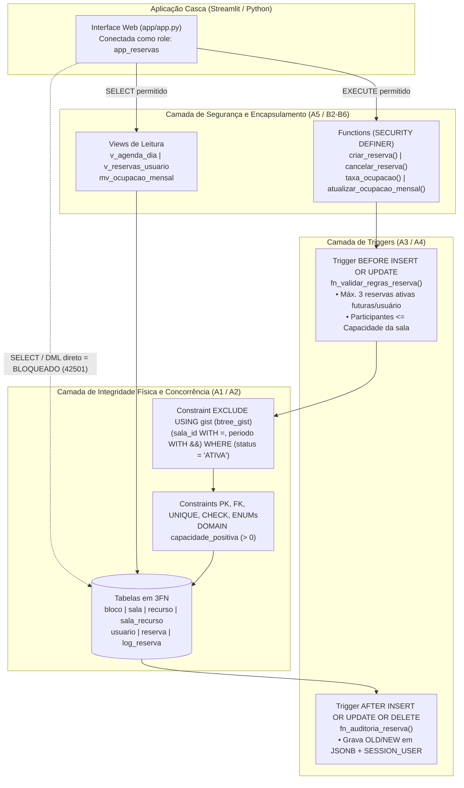
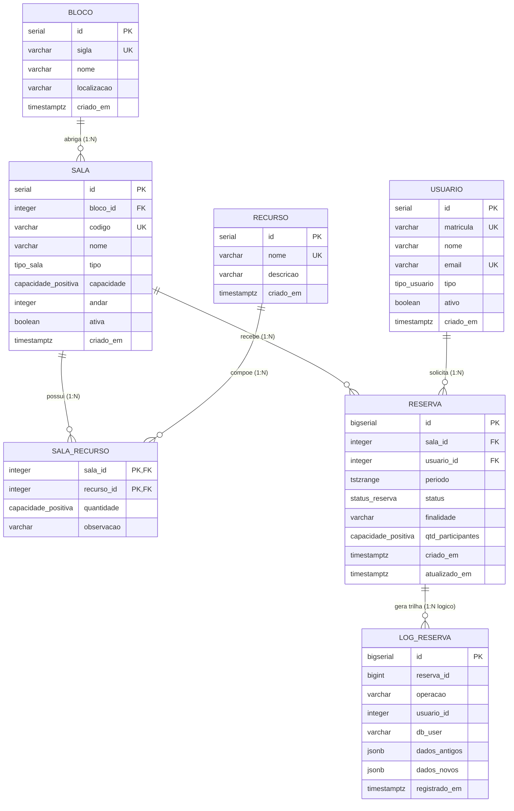

# 🏛️ Sistema de Reserva de Salas e Laboratórios Acadêmicos


Sistema completo de gerenciamento de reservas de salas de aula, laboratórios, auditórios e salas de reunião projetado sob a arquitetura **Database-First (Thick Database)** no **PostgreSQL 16**.

Neste projeto, **100% das regras de negócio, integridade temporal, controle de concorrência, auditoria e segurança de acesso são garantidas diretamente pelo SGBD** — a aplicação web atua exclusivamente como uma camada visual (*casca*) conectada com privilégios mínimos (`app_reservas`), sem nenhuma validação de negócio em código de aplicação.

---

## 🧭 Sumário

1. [Arquitetura em Camadas no PostgreSQL](#-arquitetura-em-camadas-no-postgresql)
2. [Modelo Entidade-Relacionamento (DER em 3FN)](#-modelo-entidade-relacionamento-der-em-3fn)
3. [Destaques de Engenharia de Banco de Dados](#-destaques-de-engenharia-de-banco-de-dados)
4. [Estrutura do Repositório](#-estrutura-do-repositório)
5. [Guia Rápido de Instalação e Execução](#-guia-rápido-de-instalação-e-execução)
6. [Como Testar e Validar (UI, Testes E2E e Concorrência)](#-como-testar-e-validar-ui-testes-e2e-e-concorrência)
7. [Resultados de Desempenho (`EXPLAIN ANALYZE`)](#-resultados-de-desempenho-explain-analyze)
8. [Mapa de Entregáveis por Task (J, A e B)](#-mapa-de-entregáveis-por-task-j-a-e-b)

---

## 🏗️ Arquitetura em Camadas no PostgreSQL

A aplicação nunca acessa tabelas diretamente (`REVOKE ALL`). Toda leitura ocorre por **Views** e **Materialized Views**, e toda escrita ocorre via **Stored Functions (`SECURITY DEFINER`)** protegidas por **Triggers** e **Constraints declarativas**:



---

## 📐 Modelo Entidade-Relacionamento (DER em 3FN)

O modelo relacional encontra-se integralmente na **3ª Forma Normal (3FN)**, eliminando dependências parciais (via tabela associativa `sala_recurso`) e dependências transitivas (via extração da entidade `bloco` referenciada por `sala`):



---

## ⚡ Destaques de Engenharia de Banco de Dados

| Pilar | Implementação no PostgreSQL | Benefício Prático |
| :--- | :--- | :--- |
| **Anti-Conflito Temporal (`EXCLUDE`)** | `EXCLUDE USING gist (sala_id WITH =, periodo WITH &&) WHERE (status = 'ATIVA')` sobre `tstzrange` semiaberto `[)` | Impede reservas sobrepostas na mesma sala mesmo sob alta concorrência; permite reservas adjacentes (`10h–11h` e `11h–12h`) e ignora reservas `CANCELADAS`. |
| **Regras de Negócio em Trigger** | `BEFORE INSERT OR UPDATE` (`fn_validar_regras_reserva`) | Garante no máximo **3 reservas ativas futuras por usuário** (ignorando a própria linha `r.id <> NEW.id` em `UPDATE`) e valida `qtd_participantes <= sala.capacidade`. |
| **Auditoria Imutável em JSONB** | `AFTER INSERT OR UPDATE OR DELETE` (`fn_auditoria_reserva`) | Registra automaticamente toda criação, edição ou cancelamento em `log_reserva` com snapshots `OLD` e `NEW` em `JSONB`, timestamp e usuário da sessão. |
| **Segurança e Privilégio Mínimo** | Role `app_reservas` com `REVOKE ALL` nas tabelas + Functions `SECURITY DEFINER SET search_path = public, pg_temp` | Bloqueia qualquer `SELECT/INSERT/UPDATE/DELETE` direto nas tabelas e previne ataques de *search_path hijacking*. |
| **Relatório Mensal Concorrente** | Materialized View `mv_ocupacao_mensal` + índice único `(sala_id, mes_referencia)` | Suporta atualização a quente via `REFRESH MATERIALIZED VIEW CONCURRENTLY` sem bloquear leituras da aplicação. |

---

## 📂 Estrutura do Repositório

```text
reservas-db/
├── app/                               # Aplicação Casca em Clean Architecture + PEP 8 (Task A7)
│   ├── domain/                        # Entidades de comando imutáveis, Port (Protocol) e DatabaseRuleError
│   ├── application/                   # Casos de uso (ReservaApplicationService) sem validação na app
│   ├── infrastructure/                # Configurações de ambiente e Adapter PostgresReservaRepository
│   ├── presentation/                  # Componentes visuais Streamlit desacoplados do driver psycopg
│   └── app.py                         # Composition Root (Injeção de Dependência e entrada do Streamlit)
├── concorrencia/
│   ├── roteiro.md                     # Roteiro manual de 2 terminais psql + logs reais (Task A6)
│   └── simular_concorrencia.py        # Simulador multithread que inspeciona pg_stat_activity (Task A6)
├── docs/
│   ├── regras.md                      # Entidades, matriz de regras por camada e convenções (J1, J3)
│   ├── parte_A_guardiao.md            # DER, justificativa 3FN, ON DELETE, EXCLUDE e Segurança (J2, A8)
│   ├── parte_B_motor.md               # Functions, Views, EXPLAIN ANALYZE e 5 Consultas Analíticas (B8-B11)
│   └── roteiro_apresentacao_J4_J5.md  # Guia da arguição oral (5 perguntas) e Demo de 5 min (J4, J5)
├── sql/
│   ├── 01_schema.sql                  # ENUMs, DOMAIN capacidade_positiva, 7 Tabelas e Constraints (A1)
│   ├── 02_exclude.sql                 # Extensão btree_gist e constraint EXCLUDE USING gist (A2)
│   ├── 03_triggers.sql                # Triggers de auditoria JSONB (A3) e regras de negócio (A4)
│   ├── 04_functions_views.sql         # Functions (B2-B4), Views (B5) e Materialized View (B6)
│   ├── 05_seed.sql                    # Seed base realista + mês de ocupação exata 10.00% (B1)
│   ├── 06_roles.sql                   # Role app_reservas, REVOKE ALL nas tabelas e GRANTs (A5)
│   ├── 07_seed_10k.sql                # Povoamento de +18.000 reservas com generate_series (B7)
│   ├── 08_indexes_explain.sql         # Dois índices parciais B-Tree e EXPLAIN ANALYZE (B8)
│   └── 09_analytics.sql               # Cinco consultas analíticas: JOIN, HAVING, Subquery, CTE, Window (B9)
├── tests/
│   └── test_e2e.py                    # Suíte automatizada de testes ponta a ponta com Pytest (B10)
├── docker-compose.yml                 # Container PostgreSQL 16 Alpine dedicado (porta 5434)
├── requirements.txt                   # Dependências Python (psycopg, streamlit, pandas, pytest)
├── reset.sh                           # Script de recriação limpa do banco (--full opcional)
└── demo_5min.sh                       # Script executável da demonstração de 5 minutos (Task J5)
```

---

## 🚀 Guia Rápido de Instalação e Execução

### Pré-requisitos
- **Docker** e **Docker Compose**
- Cliente **`psql`** (`postgresql-client`)
- **Python 3.12+** (ambiente virtual já configurado em `.venv`)

### 1. Subir o Banco de Dados PostgreSQL
```bash
docker compose up -d
```
> O container `reservas-db-pg` roda na porta **`5434`** (`127.0.0.1:5434`) para evitar conflitos com outras instâncias locais.

### 2. Inicializar / Resetar o Banco (`reset.sh`)
- **Modo Padrão (rápido, ideal para a demonstração e uso interativo — scripts `01` a `06`)**:
  ```bash
  ./reset.sh
  ```
- **Modo Completo (inclui carga de +18.000 reservas, `EXPLAIN ANALYZE` e 5 Consultas Analíticas — scripts `01` a `09`)**:
  ```bash
  ./reset.sh --full
  ```

### 3. Iniciar a Aplicação Web (Streamlit)
```bash
.venv/bin/streamlit run app/app.py
```
Acesse no navegador: **`http://localhost:8501`**

---

## 🧪 Como Testar e Validar (UI, Testes E2E e Concorrência)

### 1. Roteiro Automatizado da Demonstração de 5 Minutos (Task J5)
Executa em sequência: *reset do banco $\rightarrow$ reserva válida $\rightarrow$ conflito de horário $\rightarrow$ limite de 3 reservas futuras $\rightarrow$ cancelamento e liberação $\rightarrow$ acesso negado às tabelas base*:
```bash
./demo_5min.sh
```

### 2. Suíte de Testes Ponta a Ponta com Pytest (Task B10)
Valida automaticamente todas as constraints, triggers, functions, views, cálculo de taxa de ocupação e permissões da role `app_reservas`:
```bash
.venv/bin/pytest -v tests/test_e2e.py
```

### 3. Simulação de Concorrência entre 2 Sessões (Task A6)
Abre duas conexões concorrentes (`Sessão A` e `Sessão B`) tentando reservar o mesmo horário na mesma sala e uma 3ª conexão observadora que consulta `pg_stat_activity` (`wait_event = Lock:transactionid`), demonstrando o comportamento tanto com **`COMMIT`** quanto com **`ROLLBACK`**:
```bash
.venv/bin/python concorrencia/simular_concorrencia.py
```

---

## 📈 Resultados de Desempenho (`EXPLAIN ANALYZE`)

Após o povoamento com **18.459 reservas** ([`sql/07_seed_10k.sql`](sql/07_seed_10k.sql)), criamos dois índices B-Tree parciais (`WHERE status = 'ATIVA'`) que complementam o índice GiST do `EXCLUDE` sem duplicá-lo ([`sql/08_indexes_explain.sql`](sql/08_indexes_explain.sql)):

| Consulta Analisada | Antes do Índice | Depois do Índice | Redução de Tempo | Redução de I/O (Buffers) |
| :--- | :--- | :--- | :---: | :---: |
| **1. Agenda do Dia ordenada por horário**<br/>`idx_reserva_data_inicio_ativa` | `Seq Scan` (`12,296 ms`) | `Bitmap Index Scan` (`0,190 ms`) | **64,7x mais rápida** | `307` $\rightarrow$ `3` páginas (**-99%**) |
| **2. Reservas Ativas de um Usuário**<br/>`idx_reserva_usuario_ativa` | `Seq Scan` (`4,202 ms`) | `Bitmap Index Scan` (`0,391 ms`) | **10,7x mais rápida** | `307` $\rightarrow$ `21` páginas (**-93%**) |

---

## 🗺️ Mapa de Entregáveis por Task (J, A e B)

| Task | Responsável | Descrição | Entregável |
| :---: | :---: | :--- | :--- |
| **J1** | Dupla | Levantamento de entidades, atributos e regras por camada | [`docs/regras.md`](docs/regras.md) |
| **J2** | Dupla | DER conceitual e lógico + rascunho da 3FN | [`docs/parte_A_guardiao.md`](docs/parte_A_guardiao.md) |
| **J3** | Dupla | Convenções do time, padrão de erros e script `reset.sh` | [`docs/regras.md`](docs/regras.md) · [`reset.sh`](reset.sh) |
| **A1** | Pessoa A | Schema base (`ENUM`, `DOMAIN`, 7 tabelas, `ON DELETE` justificados) | [`sql/01_schema.sql`](sql/01_schema.sql) |
| **A2** | Pessoa A | Constraint `EXCLUDE USING gist` anti-conflito | [`sql/02_exclude.sql`](sql/02_exclude.sql) |
| **A3** | Pessoa A | Tabela `log_reserva` e Trigger de auditoria em `JSONB` | [`sql/03_triggers.sql`](sql/03_triggers.sql) |
| **A4** | Pessoa A | Trigger de regra de negócio (limite de 3 reservas futuras e lotação) | [`sql/03_triggers.sql`](sql/03_triggers.sql) |
| **A5** | Pessoa A | Role `app_reservas`, `REVOKE ALL`, `GRANT` e `SECURITY DEFINER` | [`sql/06_roles.sql`](sql/06_roles.sql) |
| **A6** | Pessoa A | Roteiro de concorrência com 2 sessões (`COMMIT` e `ROLLBACK`) | [`concorrencia/roteiro.md`](concorrencia/roteiro.md) · [`concorrencia/simular_concorrencia.py`](concorrencia/simular_concorrencia.py) |
| **A7** | Pessoa A | Aplicação (casca) em Streamlit repassando mensagens do banco | [`app/app.py`](app/app.py) |
| **A8** | Pessoa A | Documentação técnica completa da Parte A ("Guardião") | [`docs/parte_A_guardiao.md`](docs/parte_A_guardiao.md) |
| **B1** | Pessoa B | Seed base realista + mês com ocupação conhecida (Set/2026 = 10,00%) | [`sql/05_seed.sql`](sql/05_seed.sql) |
| **B2** | Pessoa B | Function `criar_reserva` com captura de `exclusion_violation` | [`sql/04_functions_views.sql`](sql/04_functions_views.sql) |
| **B3** | Pessoa B | Function `cancelar_reserva` validando titularidade e status | [`sql/04_functions_views.sql`](sql/04_functions_views.sql) |
| **B4** | Pessoa B | Function `taxa_ocupacao(sala, mes)` | [`sql/04_functions_views.sql`](sql/04_functions_views.sql) |
| **B5** | Pessoa B | Views `v_agenda_dia` e `v_reservas_usuario` | [`sql/04_functions_views.sql`](sql/04_functions_views.sql) |
| **B6** | Pessoa B | Materialized View `mv_ocupacao_mensal` com índice único concorrente | [`sql/04_functions_views.sql`](sql/04_functions_views.sql) |
| **B7** | Pessoa B | Povoamento de +10.000 reservas com `generate_series` e `ON CONFLICT` | [`sql/07_seed_10k.sql`](sql/07_seed_10k.sql) |
| **B8** | Pessoa B | Dois índices parciais e análise de `EXPLAIN ANALYZE` antes/depois | [`sql/08_indexes_explain.sql`](sql/08_indexes_explain.sql) · [`docs/parte_B_motor.md`](docs/parte_B_motor.md) |
| **B9** | Pessoa B | Cinco consultas analíticas (`JOIN`, `HAVING`, Subquery, CTE, Window) | [`sql/09_analytics.sql`](sql/09_analytics.sql) · [`docs/parte_B_motor.md`](docs/parte_B_motor.md) |
| **B10** | Pessoa B | Testes ponta a ponta automatizados da aplicação | [`tests/test_e2e.py`](tests/test_e2e.py) |
| **B11** | Pessoa B | Documentação técnica completa da Parte B ("Motor") | [`docs/parte_B_motor.md`](docs/parte_B_motor.md) |
| **J4** | Dupla | Guia para o ensaio da defesa oral (5 perguntas cruzadas) | [`docs/roteiro_apresentacao_J4_J5.md`](docs/roteiro_apresentacao_J4_J5.md) |
| **J5** | Dupla | Roteiro executável da demonstração de 5 minutos | [`demo_5min.sh`](demo_5min.sh) · [`docs/roteiro_apresentacao_J4_J5.md`](docs/roteiro_apresentacao_J4_J5.md) |
