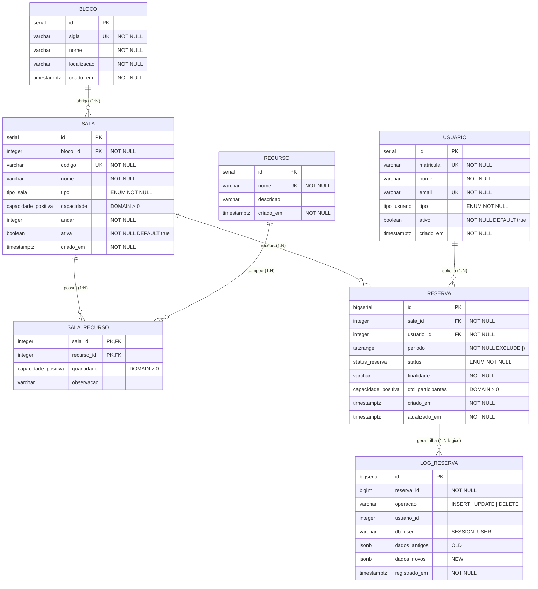

# Documentação Parte A — "Guardião" (Integridade, Regras, 3FN, Segurança e Concorrência)

**Tasks cobertas:** J2, A1, A2, A3, A4, A5, A6, A7 e A8.

---

## 1. Diagrama Entidade-Relacionamento (DER) e Cardinalidades (J2 / A8)



### Explicação dos Relacionamentos e Cardinalidades (J2)

1. **`bloco (1) ─── (0..N) sala`**:
   - Cada sala pertence obrigatoriamente a **1** bloco (`bloco_id NOT NULL`).
   - Um bloco pode ter várias salas cadastradas (`0..N`).
2. **`sala (0..N) ─── (0..N) recurso` resolvido via `sala_recurso`**:
   - Uma sala pode possuir múltiplos recursos (ex.: projetor, 30 computadores, quadro branco), e um mesmo tipo de recurso está presente em várias salas.
   - A tabela associativa `sala_recurso` materializa esse relacionamento $N:N$ com chave primária composta `(sala_id, recurso_id)` e o atributo próprio do vínculo `quantidade` (quantas unidades daquele equipamento existem naquela sala).
3. **`sala (1) ─── (0..N) reserva`**:
   - Cada reserva refere-se a exatamente **1** sala (`sala_id NOT NULL`).
   - Uma sala acumula diversas reservas ao longo do tempo (`0..N`), desde que não haja sobreposição temporal entre reservas `ATIVAS`.
4. **`usuario (1) ─── (0..N) reserva`**:
   - Cada reserva tem exatamente **1** usuário responsável/titular (`usuario_id NOT NULL`).
   - Um usuário pode realizar várias reservas ao longo do tempo (`0..N`), limitado pela regra de negócio a no máximo 3 reservas `ATIVAS` futuras simultâneas.

---

## 2. Justificativa da 3ª Forma Normal (3FN) e Exemplos de Violação (A8)

Todas as tabelas de domínio do sistema estão na **Terceira Forma Normal (3FN)**:

### 2.1. Primeira Forma Normal (1FN) — Atomicidade e Ausência de Grupos Repetitivos
- **Como o schema respeita a 1FN**: Todos os atributos contêm valores indivisíveis pelo modelo relacional de domínio, sem listas separadas por vírgula ou colunas repetidas (`recurso_1`, `recurso_2`). Note que `periodo` usa o tipo nativo `tstzrange` do PostgreSQL porque o intervalo semiaberto `[início, fim)` é a unidade semântica indivisível da álgebra de intervalos (indexada pelo GiST).
- **Exemplo do que violaria a 1FN**:
  Criar na tabela `sala` uma coluna textual `recursos_instalados VARCHAR(500)` contendo `'Projetor 4K, 30x Computador i7, Quadro Branco'`. Isso impediria consultar com integridade referencial quais salas possuem computador ou somar quantidades de equipamentos. A solução na 1FN foi extrair `recurso` e `sala_recurso`.

### 2.2. Segunda Forma Normal (2FN) — Dependência Funcional Total da Chave Primária Composta
- **Como o schema respeita a 2FN**: Nas tabelas de chave simples (`bloco`, `usuario`, `sala`, `recurso`, `reserva`), a 2FN é satisfeita automaticamente. Na única tabela com chave primária composta — `sala_recurso (sala_id, recurso_id)` — os atributos não-chave (`quantidade` e `observacao`) dependem do par completo `(sala_id, recurso_id)` (a quantidade de computadores depende de *qual sala* e de *qual recurso*).
- **Exemplo do que violaria a 2FN**:
  Colocar a coluna `nome_recurso` ou `capacidade_sala` dentro de `sala_recurso (sala_id, recurso_id)`. Nesse caso, `nome_recurso` dependeria apenas de `recurso_id` (parte da PK composta) e `capacidade_sala` dependeria apenas de `sala_id` (dependência parcial), gerando anomalias de atualização.

### 2.3. Terceira Forma Normal (3FN) — Ausência de Dependências Transitivas
- **Como o schema respeita a 3FN**: Nenhum atributo não-chave determina outro atributo não-chave ($X \rightarrow Y \rightarrow Z$, onde $X$ é a PK e $Y, Z$ são atributos não-chave).
- **Exemplos concretos do que violaria a 3FN (e como evitamos)**:
  1. **Dados do Bloco dentro de `sala`**: Se mantivéssemos `bloco_sigla`, `bloco_nome` e `bloco_localizacao` diretamente na tabela `sala`, teríamos a dependência transitiva:
     $$\text{sala.id} \rightarrow \text{bloco\_sigla} \rightarrow (\text{bloco\_nome}, \text{bloco\_localizacao})$$
     Se o nome do `'BL-B'` mudasse de `'Bloco B — Laboratórios de TI'` para `'Bloco B — Computação'`, precisaríamos atualizar dezenas de linhas em `sala` (anomalia de atualização). Por isso extraímos a tabela `bloco` e deixamos apenas `bloco_id` em `sala`.
  2. **Dados do Usuário ou da Sala dentro de `reserva`**: Se gravássemos `usuario_nome`, `usuario_email` ou `sala_codigo` na tabela `reserva`, teríamos:
     $$\text{reserva.id} \rightarrow \text{usuario\_id} \rightarrow (\text{usuario\_nome}, \text{usuario\_email})$$
     Na tabela `reserva` mantemos apenas `sala_id` e `usuario_id`.

---

## 3. Integridade Declarativa e Justificativa de cada `ON DELETE` (A1 / A2)

### 3.1. Justificativa das Cláusulas `ON DELETE` nas Chaves Estrangeiras

| Constraint FK | Tabela Origem $\rightarrow$ Destino | Política Escolhida | Justificativa de Engenharia de Dados |
| :--- | :--- | :---: | :--- |
| **`fk_sala_bloco`** | `sala.bloco_id` $\rightarrow$ `bloco.id` | **`ON DELETE RESTRICT`** | Impede apagar acidentalmente um prédio/bloco inteiro que ainda possui salas vinculadas. |
| **`fk_sala_recurso_sala`** | `sala_recurso.sala_id` $\rightarrow$ `sala.id` | **`ON DELETE CASCADE`** | `sala_recurso` representa a composição física do inventário da sala. Caso uma sala recém-cadastrada (sem histórico de reservas) seja excluída, seus vínculos de equipamentos não têm sentido órfãos e são removidos em cascata. |
| **`fk_sala_recurso_recurso`** | `sala_recurso.recurso_id` $\rightarrow$ `recurso.id` | **`ON DELETE RESTRICT`** | Protege o catálogo de recursos: impede excluir um equipamento (ex.: `'Projetor Laser 4K'`) enquanto ele constar instalado em alguma sala. |
| **`fk_reserva_sala`** | `reserva.sala_id` $\rightarrow$ `sala.id` | **`ON DELETE RESTRICT`** | **Preservação de histórico**: uma sala que já teve reservas nunca deve ser apagada fisicamente (o que destruiria os relatórios de ocupação passada). Para desativar uma sala, usa-se `sala.ativa = FALSE`. |
| **`fk_reserva_usuario`** | `reserva.usuario_id` $\rightarrow$ `usuario.id` | **`ON DELETE RESTRICT`** | **Preservação de autoria e auditoria**: impede apagar um aluno ou professor que já realizou reservas. Quando um usuário deixa a instituição, usa-se `usuario.ativo = FALSE`. |

### 3.2. Funcionamento da Constraint `EXCLUDE USING gist` (A2)

Em `sql/02_exclude.sql`, habilitamos a extensão `btree_gist` e declaramos:

```sql
CREATE EXTENSION IF NOT EXISTS btree_gist;

ALTER TABLE reserva
    ADD CONSTRAINT ex_reserva_conflito_horario
    EXCLUDE USING gist (
        sala_id WITH =,
        periodo WITH &&
    )
    WHERE (status = 'ATIVA');
```

- **Por que `btree_gist` é necessária?** O método de índice GiST nativo sabe indexar operadores geométricos e de intervalos (`periodo WITH &&`), mas precisa da extensão `btree_gist` para combinar na mesma chave de índice uma comparação escalar de igualdade (`sala_id WITH =`) com uma interseção de `tstzrange` (`periodo WITH &&`).
- **Por que reservas adjacentes (10h–11h e 11h–12h) não conflitam?** Porque o tipo `tstzrange` utiliza limites semiabertos `[)` (fechado no início, aberto no fim, garantido também pela constraint `ck_reserva_periodo_semiaberto`). Assim, o instante `11:00` não pertence a `[10:00, 11:00)`, mas pertence a `[11:00, 12:00)`, resultando em `[10:00, 11:00) && [11:00, 12:00) = FALSE`.
- **Por que reservas canceladas não bloqueiam o horário?** Porque o índice GiST da constraint `EXCLUDE` é **parcial** (`WHERE (status = 'ATIVA')`). Quando `cancelar_reserva` muda o status para `'CANCELADA'`, a tupla deixa de fazer parte do predicado parcial do índice e o horário fica imediatamente disponível para novas reservas.

---

## 4. Triggers de Auditoria e de Regra de Negócio (A3 / A4)

### 4.1. Trigger de Auditoria (`trg_auditoria_reserva` — A3)
- Dispara `AFTER INSERT OR UPDATE OR DELETE ON reserva FOR EACH ROW`.
- Registra em `log_reserva` a operação (`TG_OP`), o `reserva_id`, o `usuario_id`, o usuário de sessão do banco (`SESSION_USER`), o registro anterior (`to_jsonb(OLD)`) e o novo (`to_jsonb(NEW)`).
- Como a função `fn_auditoria_reserva()` é `SECURITY DEFINER`, a tabela `log_reserva` permanece 100% inacessível para leitura ou escrita direta pela role `app_reservas`, mas toda operação feita via `criar_reserva` ou `cancelar_reserva` é auditada com segurança.

### 4.2. Trigger de Regra de Negócio (`trg_validar_regras_reserva` — A4)
- Dispara `BEFORE INSERT OR UPDATE ON reserva FOR EACH ROW`.
- **Regra 1 (Capacidade)**: Verifica se `NEW.qtd_participantes <= sala.capacidade` e se a sala e o usuário estão ativos.
- **Regra 2 (Limite de 3 reservas ativas futuras por usuário)**:
  ```sql
  SELECT COUNT(*)
    INTO v_qtd_ativas_fut
    FROM reserva r
   WHERE r.usuario_id = NEW.usuario_id
     AND r.status = 'ATIVA'
     AND upper(r.periodo) > CURRENT_TIMESTAMP
     AND (TG_OP = 'INSERT' OR r.id <> NEW.id);
  ```
- **Cuidado essencial em `UPDATE`**: A cláusula `(TG_OP = 'INSERT' OR r.id <> NEW.id)` ignora a própria linha quando uma reserva existente sofre atualização. Sem isso, um usuário que já possui 3 reservas ativas futuras ficaria impedido de atualizar a finalidade ou o número de participantes de uma de suas próprias reservas.

---

## 5. Segurança em Nível de Banco: Role `app_reservas` e `SECURITY DEFINER` (A5)

Em `sql/06_roles.sql`, implementamos o princípio do privilégio mínimo:
1. Criamos a role `app_reservas` (utilizada pela aplicação Streamlit em `app/app.py`).
2. Executamos `REVOKE ALL` em todas as 7 tabelas base (`bloco`, `usuario`, `sala`, `recurso`, `sala_recurso`, `reserva`, `log_reserva`) e sequências.
3. Concedemos `GRANT SELECT` apenas nas Views (`v_agenda_dia`, `v_reservas_usuario`, `v_catalogo_salas`, `v_catalogo_usuarios`) e na Materialized View (`mv_ocupacao_mensal`).
4. Concedemos `GRANT EXECUTE` apenas nas Functions de negócio (`criar_reserva`, `cancelar_reserva`, `taxa_ocupacao`, `atualizar_ocupacao_mensal`).
5. As functions que gravam ou leem tabelas protegidas foram declaradas com:
   ```sql
   SECURITY DEFINER
   SET search_path = public, pg_temp
   ```
   - **Por que `SET search_path = public, pg_temp` é obrigatório junto com `SECURITY DEFINER`?**
     Porque uma função `SECURITY DEFINER` roda com os privilégios do seu criador (`postgres`). Se o `search_path` não for fixado na definição da função, um usuário malicioso poderia criar objetos homônimos (como uma tabela ou função falsa) em um schema temporário/próprio e manipular o `search_path` da sessão para executar código arbitrário com privilégio de superusuário. Fixar `SET search_path = public, pg_temp` blinda a função contra esse vetor de ataque.
